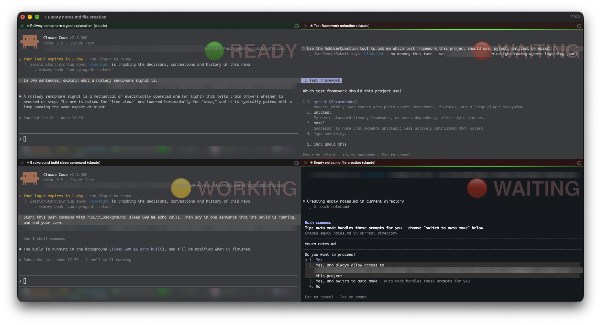

# cc-iterm-semaphore

See at a glance which of your [Claude Code](https://code.claude.com) sessions in iTerm2 needs you.

When you run several Claude Code sessions side by side, it's hard to tell which one is still working, which is waiting for an answer, and which has finished. This Claude Code hook puts a large, faint badge in the corner of each iTerm2 pane, colours the tab, and bounces the Dock icon when a session needs you.



| Badge | Tab | Meaning |
|---|---|---|
| 🔴 WAITING | red | Claude needs you: a permission prompt, a question, a plan to approve, or an API error. The Dock icon bounces once. |
| 🟡 WORKING | default | Claude is working, or its turn has ended while background tasks are still running. |
| 🟢 READY | green | Claude has finished and is ready for your next prompt. |

The badge is per pane, so it works for split layouts. The tab colour helps when each session has its own tab.

## Requirements

- macOS with **iTerm2 3.7 or newer**. The watcher uses the bundled `it2` command, which needs iTerm2's Python API enabled (*Settings → General → Magic → Enable Python API*).
- [Claude Code](https://code.claude.com)
- `jq` (`brew install jq`)

## Install

```sh
git clone git@github.com:dominik-hadl/cc-iterm-semaphore.git
cd cc-iterm-semaphore
./install.sh
```

`install.sh` registers `bin/cc-semaphore` for the relevant hook events in `~/.claude/settings.json`. It backs the file up first, leaves your other hooks alone, and is safe to run again, for example after moving the folder. Running sessions pick it up on their next event.

To remove it, run `./uninstall.sh`. It unregisters the hook and clears all badges and tab colours.

## How it works

**`bin/cc-semaphore`** is the hook. Claude Code runs it on every lifecycle event and passes the event as JSON. The hook works out the session's state from the event:

| Event | State |
|---|---|
| `SessionStart`, `Stop` | ready (or still working if background tasks are running) |
| `UserPromptSubmit`, `PreToolUse`, `PostToolUse` | working |
| `PermissionRequest`, `Notification` (permission prompt), `StopFailure` | waiting |
| `AskUserQuestion`, `ExitPlanMode`, MCP `Elicitation` | waiting (answering triggers `PostToolUse`) |
| `SessionEnd` | badge and tab colour cleared |

It then writes iTerm2's escape sequences for the badge, the tab colour and the Dock bounce to the session's terminal. State is kept per iTerm2 session in `$TMPDIR/cc-semaphore/`, so nothing is redrawn unless the state changes.

**`bin/cc-semaphore-watch`** covers the moments when Claude Code fires no hook at all:

- **Esc interrupt.** Without it, the badge would stay on WORKING forever.
- **Approving a permission prompt.** Without it, the badge would stay on WAITING until the command finishes.
- **Claude quitting without `SessionEnd`**, for example when it's killed.

The watcher starts automatically, checks the session titles once a second, and exits two minutes after the last session ends. Claude Code puts a spinner (◐ ◑) at the start of the terminal title while it works and ✳ when it stops. The watcher corrects the state only when the title and the state disagree on two checks in a row and the state has been unchanged for at least two seconds. It never overrides a question or plan approval: a running background agent keeps the spinner turning even while a question is on screen. Each correction is logged in `$TMPDIR/cc-semaphore/.watch.log`.

**iTerm2's built-in Claude Code integration** (*iTerm2 → Install Claude Code Integration*) is optional and works alongside this one. It adds a status dot to tabs, the *Session Status* toolbelt and the *Cockpit* overview (⌥⇧⌘C). When the watcher corrects a state, it also updates iTerm2's integration if it's installed, so both agree.

## Configuration

Set these environment variables where Claude Code will see them, for example in `~/.zshenv`:

| Variable | Default | |
|---|---|---|
| `CC_SEMAPHORE_BADGE` | `1` | `0` turns off badges |
| `CC_SEMAPHORE_BADGE_WAITING` | `🔴 WAITING` | badge texts |
| `CC_SEMAPHORE_BADGE_WORKING` | `🟡 WORKING` | |
| `CC_SEMAPHORE_BADGE_IDLE` | `🟢 READY` | |
| `CC_SEMAPHORE_TAB` | `1` | `0` turns off tab colours |
| `CC_SEMAPHORE_WAITING` / `CC_SEMAPHORE_IDLE` | `#e5484d` / `#2fbf71` | tab colours |
| `CC_SEMAPHORE_BOUNCE` | `1` | `0` turns off the Dock bounce |
| `CC_SEMAPHORE_LOG` | (unset) | a file path to log every hook event to |

The badge's colour, size and position are iTerm2 profile settings: *Settings → Profiles → General → Badge*.

## Limitations

- **iTerm2 only.** Other terminals ignore the escape sequences.
- **Corrections are delayed.** The watcher's fixes take about two to three seconds.
- **Plain-text questions show as READY.** If Claude asks something in its reply instead of with the question tool, its turn has ended, so the badge shows 🟢 READY.
- **Not verified against tmux or SSH sessions.**

## License

[MIT](LICENSE). Not affiliated with Anthropic or iTerm2.
